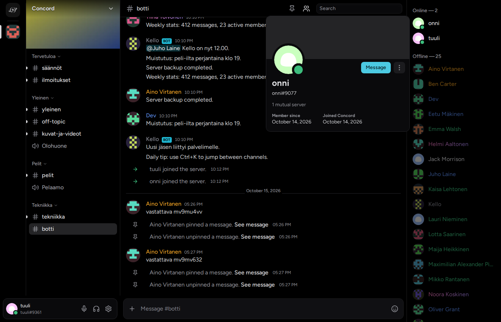

# Concord

A Discord-style chat and voice app for one private community of about 200 people in Finland, built on a self-hosted, unmodified [Stoat](https://github.com/stoatchat/stoatchat) 0.15.5 backend (formerly Revolt). The backend is a dependency we operate, not a thing we build: everything people see and touch is ours. Concord is a working name.

One SvelteKit app holds the chat client today and the website from M6, and the same client becomes the Windows and Linux desktop app through an Electron shell. Registration is invite-only, and one person operates the whole system on a single VPS.



`actions.png` shows the message action bar and `people-blocked.png` the blocked-messages notice. All three are in the repo root.

## Status

Concord is built milestone by milestone; [docs/milestones.md](docs/milestones.md) is the roadmap. Running on production at `concord.jaalip.com/app`:

- **M0 to M4**: the Stoat stack on a single VPS; login with TOTP; the read-only client; text chat, DMs, friends, reactions, search, attachments, notifications; server administration; voice channels and DM calls with camera and 1080p60 screen share.
- **M4.1, M4.2, M4.4, M4.5**: UI alignment fixes; a motion spec; Concord's own layer beside Stoat (its own sessions, permissions, gates and a SQLite store); right-click menus, GIFs, quick voice controls, server tags.

Landing task by task now:

- **M4.6**, motion and design parity with Discord, from a spec measured frame by frame.
- **M4.7**, moderation: moving people between calls, server mute and deafen, timeouts, slow mode, bulk delete, the audit log, reports.
- **M4.8**, everyday usability: the quick switcher and shortcuts, a mentions inbox, My Account in the app, server folders, drafts, appearance.

Ahead: **M5** desktop apps, **M6** the website, **M7** Finnish locale, PWA and closed beta, **M8** launch, **M9** a native Linux client.

## Stack

| Layer | What |
|---|---|
| Client | Svelte 5 with runes, SvelteKit 2, TypeScript strict, Vite. Scoped CSS with design tokens, no CSS framework. |
| Voice and video | LiveKit through Stoat's patched image. 1080p60 screen share with simulcast and SVC layers, camera, DM calls. |
| Backend | Stoat 0.15.5, every image pinned, run unmodified. MongoDB, Valkey, RabbitMQ, Silo, Caddy in front. |
| Concord's layer | A server-side layer inside the web app under `/app/api/v1/`: the Stoat session check, permissions, the admin gates and a SQLite store with migrations. For whatever Stoat has no place for, starting with server tags, reports and beta invitations. |
| Desktop | Electron shell loading the hosted client (M5). Windows NSIS installer, Linux Flatpak. |
| Hosting | One VPS, Docker Compose, nightly restic backups. Operator details live in the private ops notes. |

## Repository layout

```
apps/web/          SvelteKit. The client under /app, the layer's API under /app/api/v1/,
                   and from M6 the website pages.
packages/stoat/    Generated OpenAPI types, REST client, WebSocket with keepalive and
                   cold-start reconnect, event decoding. The only place that knows Stoat.
packages/domain/   Entity types, the normalised store, the permission calculator,
                   optimistic updates.
packages/ui/       Design tokens and components shared by the site and the client.
tools/seed/        Builds a realistic development dataset through the API.
tools/live/        Scripted live checks that drive a real browser against a stack.
tools/deploy/      Deploy the client, the deploy/ folder, and the spike page.
tools/lint/        Custom rules: no hard-coded colours, motion rules, no literals,
                   no personal email addresses.
deploy/            Compose files, Caddyfile, LiveKit config, account, backup and reset scripts.
spikes/            Throwaway experiments, starting with the M0 screen-share test page.
docs/              Product brief, architecture, specs, and every milestone's plan and results.
```

## Development

Needs Node 24 or newer (CI uses 26; Node runs the TypeScript tools directly), pnpm 10.34.5 through corepack, and Docker for the local Stoat stack: Docker Engine on native Linux, or Docker Desktop on WSL 2. `pnpm local:setup --start` builds that stack in `~/stoat` from the templates in `deploy/local/`. [docs/dev-environment.md](docs/dev-environment.md) section 10 has the prerequisites and the full setup.

```sh
pnpm install
pnpm verify   # everything CI checks: typecheck, lint, unit and contract tests,
              # svelte-check, and a production build
pnpm dev      # the client on http://localhost:5173, against the local stack
pnpm test     # unit and contract tests only
```

Routine commands, from the repo root:

| Command | What it does |
|---|---|
| `~/stoat/concord/dc up -d` | Starts the local Stoat stack. |
| `pnpm seed --reset` | Reseeds the development data: personas, a server, channels, messages, friends and DMs. |
| `pnpm seed password <handle>` | Prints a persona's login, so a check can sign in as it. |
| `node tools/live/src/<check>.ts` | Runs one scripted live check, for example `voice.ts` or `switcher.ts`. |
| `pnpm deploy:web`, `pnpm deploy:web:dev` | Deploys the client to production, or to the local stack. |
| `pnpm deploy:stack`, `pnpm deploy:stack:prod` | Applies `deploy/` to the local stack or to production. |

Testing stays light on purpose: unit tests for the risky core, contract tests that replay recorded Stoat fixtures from `packages/stoat/fixtures/` so a Stoat upgrade that changes the protocol fails CI, and scripted live checks for everything that needs a real browser, microphone or screen. A milestone is done when Jaakko has tested it on real devices and signed off its acceptance criteria, not when the code merges.

## Documentation

| Document | What it covers |
|---|---|
| [docs/product-brief.md](docs/product-brief.md) | What Concord is, who it is for, goals, the MVP, the quality bar. |
| [docs/architecture.md](docs/architecture.md) | Decisions, the system overview, Stoat integration, Concord's layer. |
| [docs/client.md](docs/client.md) | The client specification: layout, state, motion rules, voice. |
| [docs/milestones.md](docs/milestones.md) | M0 to M9 with acceptance criteria and status. |
| [docs/dev-environment.md](docs/dev-environment.md) | The local stack, the seed script, the fixture recorder. |
| [docs/vps-runbook.md](docs/vps-runbook.md) | Deploying to and operating the VPS. |
| [docs/design/discord-ui-motion-spec.md](docs/design/discord-ui-motion-spec.md) | Discord's motion, popups and layout, measured frame by frame. |

Every milestone keeps a plan and a results file in `docs/`, named `m<N>-plan.md` and `m<N>-results.md`.

## Licence

Concord's own code is licensed under the GNU Affero General Public License, version 3 or (at your option) any later version (`AGPL-3.0-or-later`); the full text is in [LICENSE](LICENSE). If you run a modified version as a network service, the AGPL asks you to offer its source to that service's users.

- **Vendored Stoat files**: `packages/stoat/api/0.15.5/openapi.json` and `packages/stoat/data/unicode_emoji-0.15.5.txt` are copied unchanged from [Stoat](https://github.com/stoatchat/stoatchat), which is AGPL-3.0, and keep their upstream notices.
- **Emoji images**: [Twemoji](https://github.com/jdecked/twemoji) graphics (`@twemoji/svg`), CC-BY 4.0, copied in from the npm package at build time and not stored here.
- **Dependencies**: Stoat, LiveKit and every other dependency keep their own licences.
- **Name and logo**: the Concord name and logo (`apps/web/static/app/brand/`) are not covered by the licence. All rights reserved.

Security issues: see [SECURITY.md](SECURITY.md).
